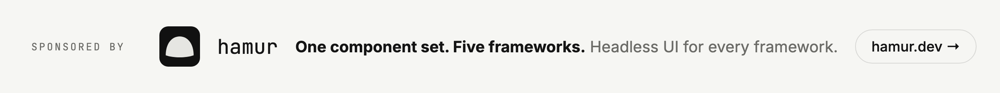
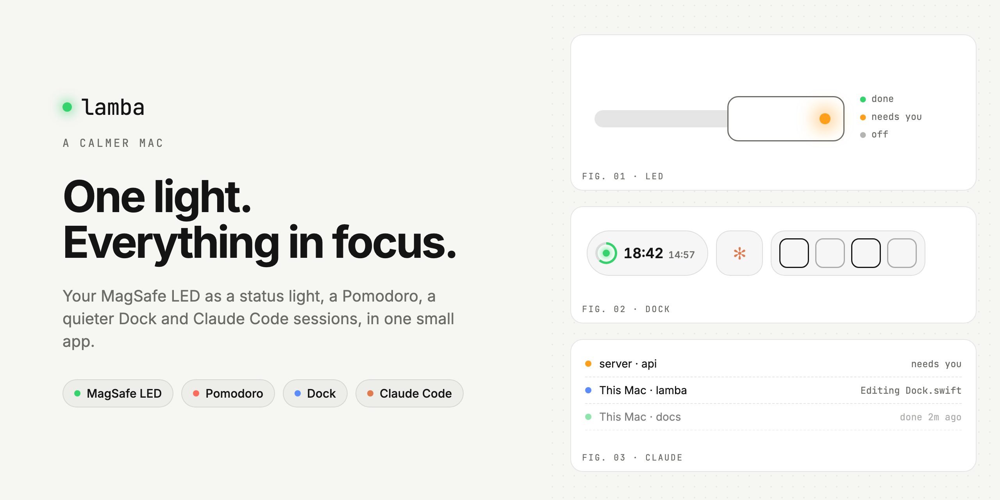

<a href="https://hamur.dev">
  <picture>
    <source media="(prefers-color-scheme: dark)" srcset=".github/assets/sponsor-dark.png">
    
  </picture>
</a>

<picture>
  <source media="(prefers-color-scheme: dark)" srcset=".github/assets/banner-dark.png">
  
</picture>

<p align="center">
  <a href="#features"><b>Features</b></a> &nbsp;·&nbsp;
  <a href="#install"><b>Install</b></a> &nbsp;·&nbsp;
  <a href="#claude-code"><b>Claude Code</b></a> &nbsp;·&nbsp;
  <a href="#command-line"><b>Command line</b></a> &nbsp;·&nbsp;
  <a href="https://github.com/sponsors/productdevbook"><b>Sponsor</b></a>
</p>

&nbsp;

Lamba is a small macOS app that makes your Mac quieter. The light on your MagSafe cable tells you
when something is done or needs you, a Pomodoro keeps your focus, and an optional Dock shows only
what matters right now, including what Claude Code is doing on this Mac and on your servers.

&nbsp;

## Features

**MagSafe status light.** Green, orange, blinking or off, by hand or from anything that can run a
command. Builds, scripts and Claude can flash it when they finish or need you.

**Pomodoro.** Click the clock to start. A ring fills around the light while you work, the keyboard
backlight dims for focus and breathes during breaks, and the trackpad taps you when a phase ends.

**A calmer Dock.** An optional replacement for the macOS Dock, made of small floating islands: the
clock and Pomodoro, Claude, your apps (with window counts and a window list), a shelf for files and
quick toggles.

**Contexts.** Work, Personal, Presenting, or your own. Each has its own apps and can change the
wallpaper, light or dark mode, run a Shortcut and open or hide apps. They switch by time, display,
Wi-Fi network, front app or screen mirroring.

**Claude Code, at a glance.** One icon shows whether Claude is working, waiting for you or done,
across this Mac and every server you connect over SSH. Allow or deny tool requests right from the
Dock, and jump to the right terminal tab with a click.

**Statistics.** Focus time per day, light and charger usage, with CSV export. Everything stays on
your Mac.

&nbsp;

## Install

With [Homebrew](https://brew.sh):

```sh
brew install --cask productdevbook/tap/lamba
```

Or **[download Lamba](https://github.com/productdevbook/lamba/releases/latest/download/Lamba.dmg)**,
open the DMG and drag Lamba to Applications. On first launch it asks for your password once to install its small helper (the only
part that talks to the LED) and the `lamba` command.

Lamba updates itself: it checks once a day and installs new versions after asking. You can also use
**Check for Updates…** in the menu bar menu or Settings › About.

Requirements: macOS 13 or later. The status light needs an Apple silicon Mac with a MagSafe 3 port;
everything else works on any Mac.

To uninstall, choose **Uninstall** in Settings › About, then move Lamba to the Trash.

&nbsp;

## Claude Code

Open **Settings › Integrations** and click **Connect**:

- **Claude Code sessions in the Dock**: working, waiting and done states, permission requests and a
  notification when a task finishes.
- **Let Claude Code control Lamba**: an MCP server, so Claude can set the light, flash it or start
  a Pomodoro.
- **Let Claude Desktop control Lamba**: the same, for Claude Desktop.
- **Other machines (SSH)**: enter `user@server` and Lamba installs its hook there and keeps a
  background tunnel, so sessions on that server show up too.

&nbsp;

## Command line

```sh
lamba set green                          # green, orange, off, system, orange-blink-slow …
lamba flash orange --times 5
lamba pomodoro start --work 50 --break 10
lamba status
lamba report --days 30 --csv

make build && lamba flash green || lamba flash orange
```

&nbsp;

## Privacy

Lamba has no account and no analytics. The only network connections it makes are the SSH tunnels
you set up. Activity statistics live in
`~/Library/Application Support/Lamba/`. The root helper accepts only a fixed list of LED states and
a sleep on/off switch, and only from you.

&nbsp;

## Development

Architecture, build and release notes are in [docs/DEVELOPMENT.md](docs/DEVELOPMENT.md).

```sh
swift test
./scripts/build-app.sh && open build/Lamba.app    # local, ad-hoc signed build
./scripts/release.sh 1.0.0                         # signed, notarized DMG + update feed
```

&nbsp;

## Sponsors

Lamba is built in public by [productdevbook](https://github.com/productdevbook). If it makes your
day calmer, consider [sponsoring](https://github.com/sponsors/productdevbook).

### hamur

Lamba is made by the people behind [hamur](https://hamur.dev), and hamur keeps it going.

hamur is a set of headless UI components for React, Vue, Svelte, Angular and Solid. Focus,
keyboard, ARIA and state, the parts that take months to get right, are written once below the
framework; a thin layer on top speaks each one. Every adapter runs the same behavior tests in
Chromium, Firefox and WebKit, so a dialog or a combobox works the same way everywhere. No styles,
your rules.

If you build interfaces for more than one framework, or want accessible components without fighting
a design system, take a look at [hamur.dev](https://hamur.dev) and the
[source on GitHub](https://github.com/productdevbook/hamur).

<a href="https://hamur.dev">
  <picture>
    <source media="(prefers-color-scheme: dark)" srcset=".github/assets/sponsor-dark.png">
    
  </picture>
</a>

&nbsp;

<sub>© productdevbook. All rights reserved. Lamba is not affiliated with Apple or Anthropic. MagSafe is a trademark of Apple Inc.</sub>
