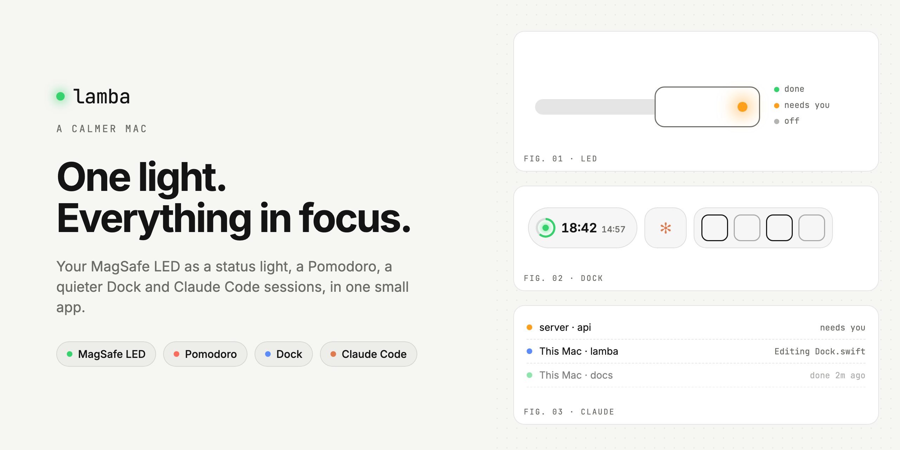
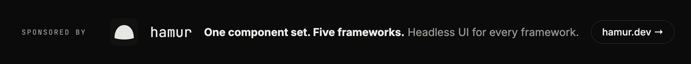

<picture>
  <source media="(prefers-color-scheme: dark)" srcset="https://raw.githubusercontent.com/productdevbook/lamba/main/.github/assets/banner-dark.png">
  
</picture>

The first release of **Lamba**, a small macOS app that makes your Mac quieter. The light on your MagSafe cable tells you when something is done or needs you, a Pomodoro keeps your focus, and an optional Dock shows only what matters right now.

## Install

```sh
brew install --cask productdevbook/tap/lamba
```

Or download **Lamba.dmg** below, open it and drag Lamba to Applications. The app is signed and notarized by Apple, and it updates itself from now on.

Requires macOS 13 or later. The status light needs an Apple silicon Mac with a MagSafe 3 port; everything else works on any Mac.

## What's inside

**💡 MagSafe status light.** Green, orange, blinking or off, by hand, from the command line or from Claude. Builds and scripts can flash it when they finish or need you, and the keyboard backlight and Caps Lock light can blink along.

**🍅 Pomodoro.** Click the clock to start. A ring fills around the light while you work, the keyboard backlight dims for focus and breathes during breaks, and the trackpad taps you when a phase ends.

**🏝️ A calmer Dock.** An optional replacement for the macOS Dock made of floating islands: the clock and Pomodoro, Claude, your apps with window counts and a window list, a shelf for files and quick toggles.

**🗂️ Contexts.** Work, Personal, Presenting, or your own. Each has its own apps and can change the wallpaper, light or dark mode, run a Shortcut and open or hide apps. They switch by time, display, Wi-Fi network, front app or screen mirroring.

**✳️ Claude Code at a glance.** One icon shows whether Claude is working, waiting or done, on this Mac and on servers you connect over SSH. Allow or deny tool requests from the Dock or the menu bar, and jump to the right terminal tab with a click. Connect it in Settings › Integrations.

**📊 Statistics.** Focus time per day, light and charger usage, with CSV export. Everything stays on your Mac.

**🌙 Never sleep.** Keep the Mac awake even with the lid closed, from Settings or the quick toggles.

Available in English, Turkish and German.

## Made with hamur

<a href="https://hamur.dev"></a>

Lamba comes from the people behind **[hamur](https://hamur.dev)**: headless UI components for React, Vue, Svelte, Angular and Solid. Focus, keyboard, ARIA and state are written once below the framework, and every adapter runs the same behavior tests in Chromium, Firefox and WebKit. If you build interfaces for more than one framework, take a look at [hamur.dev](https://hamur.dev).

Enjoying Lamba? [Sponsor its development](https://github.com/sponsors/productdevbook) ♥
